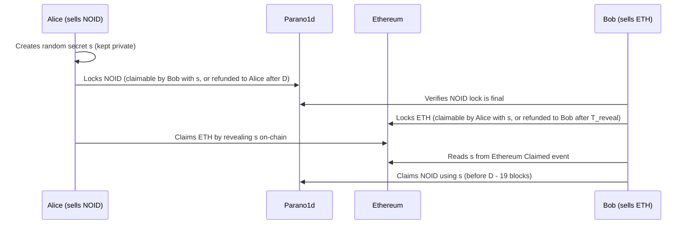
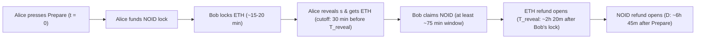

# How It Works

No1d Swap uses **hash-time-locked contracts (HTLCs)** on both Parano1d and Ethereum. You don't need to know cryptography to use the app, but understanding four core concepts makes every screen—and every safety warning—immediately obvious.

---

## Four Words to Know

* **Secret (`s`):** A random 32-byte number generated on Alice's computer when the swap starts. Nobody else knows it at first.
* **Hash-time lock:** A smart contract lock with exactly two ways out:
  1. **Before the deadline:** Opens for the counterparty when the secret is shown.
  2. **After the deadline:** Returns the coins to the person who locked them.
* **Reveal:** The moment Alice claims Bob's ETH on Ethereum by submitting the secret. Once that transaction lands on Ethereum, the secret is public—and Bob's app reads it right off the chain.
* **Deadline:** A hard time or block height after which coins go back to their original owner, so funds can never stay locked forever.

---

## The Swap in One Picture

**Alice** sells NOID. **Bob** sells ETH.

Notice what **never** happens:
* Neither person ever holds both coins at the same time (unless Bob goes offline and misses his claim window).
* No bridge, relayer, custodian, or team multisig ever touches the coins.

---

## Why the NOID Seller Always Goes First

On most chains, either side could lock first. On Parano1d, the order is fixed for an elegant cryptographic reason:

1. **Parano1d uses zero-knowledge proofs, not signatures.** When you spend a NOID coin, you prove *in zero knowledge* that you know the secret behind its address `A = Addr(s)`—without ever putting `s` on the blockchain.
2. **Because Parano1d never reveals `s`, Ethereum has to be the reveal chain.** Whoever owns `s` at the start must claim on Ethereum to make `s` public.
3. **And because `A = Addr(s)` is already a hashlock**, the Parano1d contract (`htlc.pruv`) doesn't need extra opcodes—it compiles to a single instruction.
4. **On Ethereum, `HTLCPoseidonV2` computes `Addr(s)` directly in Solidity/Yul.** Both chains lock on the exact same 32-byte value `A`, so no slow off-chain zero-knowledge equivalence proof is needed for ETH swaps.

That single design choice locks in the entire sequence:
* **Alice (NOID seller)** creates the secret, locks NOID **first** with the **longer** deadline, and reveals `s` on Ethereum.
* **Bob (ETH seller)** locks ETH **second** with the **shorter** deadline, reads `s` from Alice's Ethereum claim, and claims NOID **last**.

---

## Why the Deadlines Are Staggered

The two deadlines are deliberately unequal so both sides stay safe when everything stops mid-swap:

* **Ethereum's deadline (`T_reveal`) always expires well before Parano1d's deadline (`D`).**
  * If Alice vanishes after Bob locks ETH, Bob gets his ETH back (~2 h 20 min after his lock) without Alice ever learning a way to steal it.
  * If Alice reveals near the end of her window, her app **refuses to reveal in the final 30 minutes**—preventing a dangerous race where she publishes `s` right as Bob's refund activates.
  * Whenever Alice *does* reveal in time, Bob is guaranteed **at least ~75 minutes** to claim his NOID and wait for Parano1d finality (19 blocks) before Alice's NOID refund opens.

---

## What Happens If Something Goes Wrong?

| Scenario | Outcome for Alice (NOID) | Outcome for Bob (ETH) |
|---|---|---|
| **Either person stops before locking** | If Alice didn't fund yet, nothing moved. If she funded, NOID returns after ~6 h 45 min (minus fees). | Nothing locked; loses nothing. |
| **Bob never locks ETH** | NOID unlocks back to Alice after ~6 h 45 min (minus fees). | Nothing locked; loses nothing. |
| **Alice never reveals `s`** | NOID unlocks back to Alice after ~6 h 45 min (minus fees). | ETH refunds to Bob after ~2 h 20 min (minus gas). |
| **Alice tries to reveal too late** | App refuses in the last 30 min before `T_reveal` → safely becomes "Alice never reveals." | ETH refunds to Bob after ~2 h 20 min. |
| **Bob is offline > 75 min after Alice reveals** | Alice keeps the ETH **and** can reclaim the NOID after `D`. | **Bob loses the ETH.** Stay online after locking! |


**Good to know for Bob:** Once Alice reveals `s` on Ethereum, *anyone* who has the public swap files can broadcast Bob's NOID claim—and the contract forces the payout to go **only to Bob's address**. See [Emergency Recovery & Second-Computer Close](../troubleshooting/recovery-and-second-computer.md) if your main computer ever loses power or internet mid-swap.

